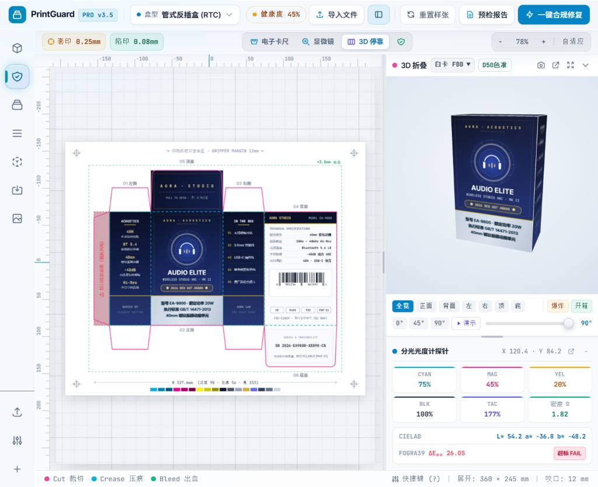
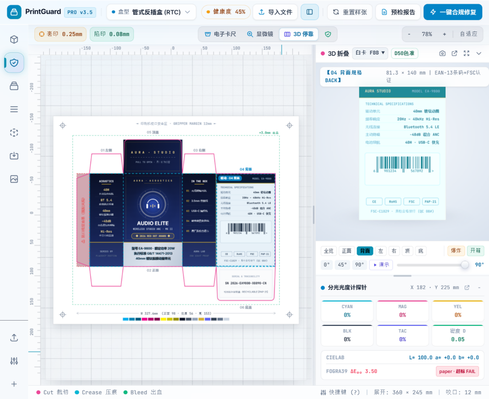
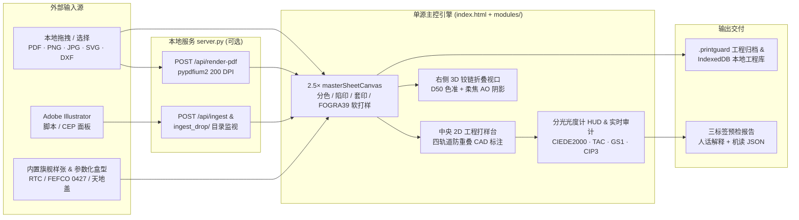

# PrintGuard Pro

**工业级印前预检、参数化刀模展开与 2D/3D 单源同步工程打样工作台**

[](./docs/架构判别报告.md)
[](./index.html)
[-16a34a?style=flat-square)](./server.py)
[](./scripts/run-tests.mjs)

**PrintGuard Pro** 面向包装印刷印前工程师、结构设计师与打样质检团队，在浏览器内提供「**真实 PDF/图稿/DXF 直导 → 印前物理光学预检 → FOGRA39 像素级软打样 → 2D/3D 同源铰链折叠 → 机读+人话预检报告**」全链路闭环。零前端打包构建步骤，开箱即用。



---

## 核心亮点

### 1. 2D / 3D 严格单源统一（Single Source of Truth）
- 中央 2D 打样画布与右侧 3D 折叠盒共享同一张 `2.5×` 超采样主控母版（`masterSheetCanvas`）与同一套物理面板坐标映射（`getBoxPanelLayout`）。
- 3D 六个面直接从 2D 对应面板裁切真实像素，物理宽高厚比例 1:1 对应，背面规格表与条码阅读方向正确无镜像。
- 任意分色切换、RGB 软打样、套印微偏移、陷印补漏白或外部图稿对齐微调，均实时同步至 2D 与 3D。

### 2. 真实印前文件直导与 FOGRA39 像素级软打样
- **全格式直导**：支持顶栏 `导入文件` 按钮或将文件直接拖入画布导入 `PDF`、`PNG`、`JPG`、`SVG` 与 AutoCAD/ArtiosCAD `DXF` 刀模。
- **真实 PDF 无损渲染**：配套 [`server.py`](./server.py) 提供 `POST /api/render-pdf` 接口（基于可选依赖 `pypdfium2` 200 DPI 渲染），精确返回真实毫米尺寸、页数与高分辨率位图。
- **源色 ⇄ CMYK 软打样对照**：对导入的真实设计稿支持 `源文件原色 (1:1)` 与 `CMYK 软打样 (FOGRA39)` 一键切换，实时统计整版 `均 ΔE₀₀` 与 `溢色像素占比 %`。
- **画布浮动对齐微调条**：导入真实图稿后自动弹出，支持「铺满刀模」「居中等比」一键适配及 `X / Y / 缩放` 精确微调。

### 3. D50 印前色准 3D 渲染与工业空间布局
- **现代化工作台架构**：单行固定 48px 顶栏 + 40px 二级分段工具栏 + 左侧 56px 活动图标停靠栏（支持悬停滑出与锁定）+ 右侧可自由拖拽宽/高缩放的双联停靠栏（上方 3D 折叠视口，下方分光光度计探针），且支持一键拆出为 8 向自由缩放浮窗。
- **D50 色准模式 & 展厅光影双模切换**：默认 `D50色准` 采用 `NoToneMapping`、中性白光与低反光漫反射材质，全贴图统一启用 `sRGBEncoding`，忠实还原 2D 源色不泛白；按需可一键切至 `展厅光影` 查看清漆与立体高光。
- **防穿插结构与柔焦接触阴影**：内折插舌、防尘翼与糊口均按纸板厚度动态内缩避让，消除盒底 Z-Fighting 闪烁；采用居中径向柔焦接触 AO 阴影替代硬边裁切阴影，仰视底盖单面自动透明无遮挡。

<details>
<summary>查看 04 背面联动检视与无遮挡角标效果截图</summary>



</details>

### 4. 完整工业印前算法引擎矩阵

| 能力域 | 核心模块 | 核心特性 |
|---|---|---|
| **包装条码与 BWR 补偿** | [`modules/module_barcode_bwr.js`](./modules/module_barcode_bwr.js) | EAN-13 / GS1-128 生成、`0.000~0.050mm` 节距不变 BWR 条宽补偿、GS1 静区实时合规核验、Canvas/SVG 双通道输出 |
| **DXF 刀模逆向解析** | [`modules/module_dxf_parser.js`](./modules/module_dxf_parser.js) | ASCII DXF（含 ArtiosCAD Bulge 凸度圆弧、`BLOCKS`/`INSERT` 展开）、裁切/压痕/标注语义分层、`$INSUNITS` 毫米归一化 |
| **任意刀线通用 3D 折叠** | [`modules/module_dxf_folder.js`](./modules/module_dxf_folder.js) | 刀线求交切分 → 半边环游面片提取 → BFS 铰链树（含 `crease`/`perf` 语义角）→ 0°~90° 通用 3D 递归折叠 |
| **色彩科学与 CIEDE2000** | [`modules/module_ciede2000.js`](./modules/module_ciede2000.js) | sRGB / XYZ / Lab / LCh 转换、D65↔D50 Bradford 色适应、ISO/CIE 11664-6 CIEDE2000（通过全部 34 组 Sharma 测试向量） |
| **参数化盒型库** | [`modules/module_new_boxes.js`](./modules/module_new_boxes.js) | 管式反插盒 (RTC)、抽屉滑盒、自动锁底盒、卷筒标签、FEFCO 0427 免胶飞机盒、精装天地盖硬盒（含 V-Groove 与开盖动画） |
| **预检人话解释与分级门禁** | [`modules/module_preflight_explainer.js`](./modules/module_preflight_explainer.js) | 离线规则三段式通俗解释（问题 / 印出后果 / 修改建议）、严格区分「安全自动修正」与「必须人工确认」、预留防篡改 LLM 接口 |
| **CIP3 墨区与损耗 EMA 预测** | [`modules/module_ink_estimator.js`](./modules/module_ink_estimator.js)<br>[`modules/module_waste_predictor.js`](./modules/module_waste_predictor.js) | 32 墨区覆盖率与四色公斤级耗墨测算；结合工单复杂度预测损耗率区间，支持实际损耗回填与 EMA（`α=0.35`）偏差自学习 |
| **数显卡尺与模切刀缝** | [`modules/module_caliper_kerf.js`](./modules/module_caliper_kerf.js) | 画布两点毫米实测卡尺（`M`）、CITO 压痕底模槽宽/槽深、折弯扣除与激光割缝 CAM 补偿 |
| **Color Workshop 工艺护照桥接** | [`modules/module_workshop_bridge.js`](./modules/module_workshop_bridge.js) | 跨项目工艺护照指纹校验门禁与 Illustrator 专色色域 / ΔE₀₀ 核验 |
| **本地持久化与外部导入** | [`js/app-store.js`](./js/app-store.js) / [`js/app-ui.js`](./js/app-ui.js)<br>[`js/app-ingest.js`](./js/app-ingest.js) | IndexedDB + localStorage 自动降级、Proxy 防抖自动保存、30 步撤销/重做、`.printguard` 工程文件导入导出、AI 草稿轮询消费 |

---

## 系统架构



---

## 快速开始

### 1. 推荐方式：启动本地服务（解锁真实 PDF 渲染与 Illustrator 桥接）

```powershell
# 可选：安装 pypdfium2 以开启真实 PDF 毫米级无损导入（不安装也可正常运行其余全部功能）
pip install -r requirements.txt

# 启动内置 HTTP 静态托管、PDF 渲染与 Ingest 接收服务（默认端口 8787，可用 --port 更改）
python server.py
```

启动后在浏览器访问：`http://127.0.0.1:8787/index.html`

> [!TIP]
> 若仅体验内置样张、图片/SVG/DXF 导入与 2D/3D 印前打样，也可不启动后端服务，直接用现代浏览器打开 [`index.html`](./index.html)（Tailwind CSS 与 Three.js 首次打开需联网加载 CDN）。

### 2. Adobe Illustrator 桥接接入

- **脚本模式**：将 [`adobe/host.jsx`](./adobe/host.jsx) 与 [`adobe/PrintGuard提取.jsx`](./adobe/PrintGuard提取.jsx) 复制至 Illustrator 的 `Presets\zh_CN\Scripts\` 目录，重启 AI 后点击「文件 → 脚本 → PrintGuard提取」。
- **CEP 面板模式**：参考 [`adobe-cep/install.md`](./adobe-cep/install.md) 开启 `PlayerDebugMode` 并安装扩展包。
- **图层命名约定**：裁切刀线图层名包含 `CUT` / `DIE` / `THRU` / `刀线` / `裁切`，压痕折线图层名包含 `CREASE` / `FOLD` / `SCORE` / `PERF` / `压痕` / `折线`；推送后自动打开 `http://127.0.0.1:8787/index.html#ingest=latest`。

---

## 仓库目录结构

```text
printguard-pro/
├── index.html                        # 主工作台单页应用（UI / Canvas 2D / Three.js 3D）
├── server.py                         # Python 本地服务（静态托管 / PDF 渲染 / AI Ingest）
├── requirements.txt                  # 可选 Python 依赖（pypdfium2）
├── css/
│   └── design-system.css             # 浅色磨砂玻璃设计系统与双联停靠/浮窗布局样式
├── js/
│   ├── app-store.js                  # 持久化存储层（IndexedDB + localStorage + 撤销栈）
│   ├── app-ui.js                     # 本地工程库管理 UI 与恢复横幅
│   └── app-ingest.js                 # Illustrator 草稿轮询消费与手动 JSON 导入
├── modules/
│   ├── module_barcode_bwr.js         # 条码生成、BWR 条宽补偿与 GS1 静区审计
│   ├── module_caliper_kerf.js        # 数显卡尺与 CITO 模切压痕/激光割缝计算
│   ├── module_ciede2000.js           # 色彩空间转换与 CIEDE2000 (ΔE₀₀) 评测引擎
│   ├── module_dxf_folder.js          # 任意刀线面邻接图与 3D 铰链通用折叠引擎
│   ├── module_dxf_parser.js          # AutoCAD / ArtiosCAD DXF 逆向解析与图层分类
│   ├── module_ink_estimator.js       # CIP3/PPF 32 墨区覆盖率与四色耗墨估算
│   ├── module_new_boxes.js           # FEFCO 0427 飞机盒与精装天地盖参数化 3D 模型
│   ├── module_preflight_explainer.js # 预检人话解释层、处置权限分级与可插拔 LLM 适配
│   ├── module_waste_predictor.js     # CIP3 损耗率区间预测与实际损耗 EMA 自学习
│   └── module_workshop_bridge.js     # Color Workshop 工艺护照门禁与专色色域核验
├── adobe/                            # Illustrator ExtendScript 一键提取脚本
├── adobe-cep/                        # Illustrator CEP 扩展面板与安装指南
├── probes/                           # 7 个浏览器端自动化回归探针（ΔE / HUD / 报告 / 恢复 / 损耗 / Ingest）
├── scripts/
│   └── run-tests.mjs                 # 一键运行全部 Node 核心单元测试
└── docs/
    ├── 架构判别报告.md               # 架构演进、技术债与路线图分析
    └── assets/                       # README 实机预览图资源
```

---

## 测试与质量验证

### 1. 一键运行全部 Node 单元测试

```powershell
node scripts/run-tests.mjs
```

自动依次运行全部 9 个算法自测模块与本地持久化存储层测试（共 10 组套件）。

### 2. 浏览器端回归探针

启动 `python server.py` 后，可在浏览器中打开以下任意探针页面自动执行并校验 `document.title`（`*_PASS`）：

- [`probes/hud_init_probe.html`](./probes/hud_init_probe.html) — 分光光度计 HUD 首帧 ΔE₀₀ / TAC 真实初值与报告模态框同源校验
- [`probes/report_real_probe.html`](./probes/report_real_probe.html) — 预检报告实测 TAC、GS1 静区/BWR 及导出 JSON 一致性校验
- [`probes/deltae_probe.html`](./probes/deltae_probe.html) — 实时 CIEDE2000 色差审计链路校验
- [`probes/explainer_probe.html`](./probes/explainer_probe.html) — 预检人话解释层与安全自动/人工确认门禁校验
- [`probes/waste_probe.html`](./probes/waste_probe.html) — CIP3 损耗预测与 EMA 回填校准校验
- [`probes/restore_probe.html`](./probes/restore_probe.html) — 本地快照参数级感知与恢复横幅校验
- [`probes/ingest_probe.html`](./probes/ingest_probe.html) — Illustrator 草稿推送、落盘与自动轮询刷新校验

---

## 延伸文档

- [架构判别报告](./docs/架构判别报告.md)
- [Adobe Illustrator CEP 面板安装指南](./adobe-cep/install.md)
